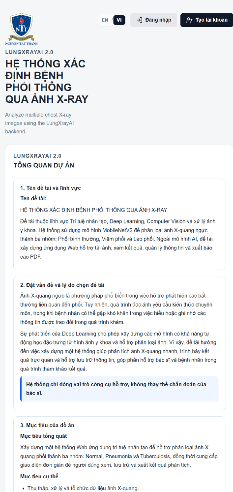
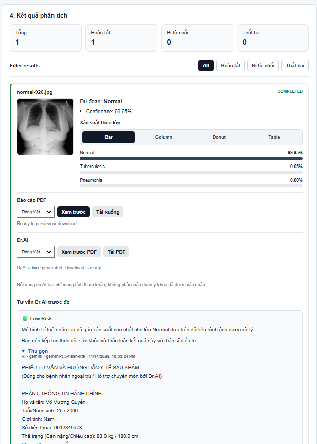
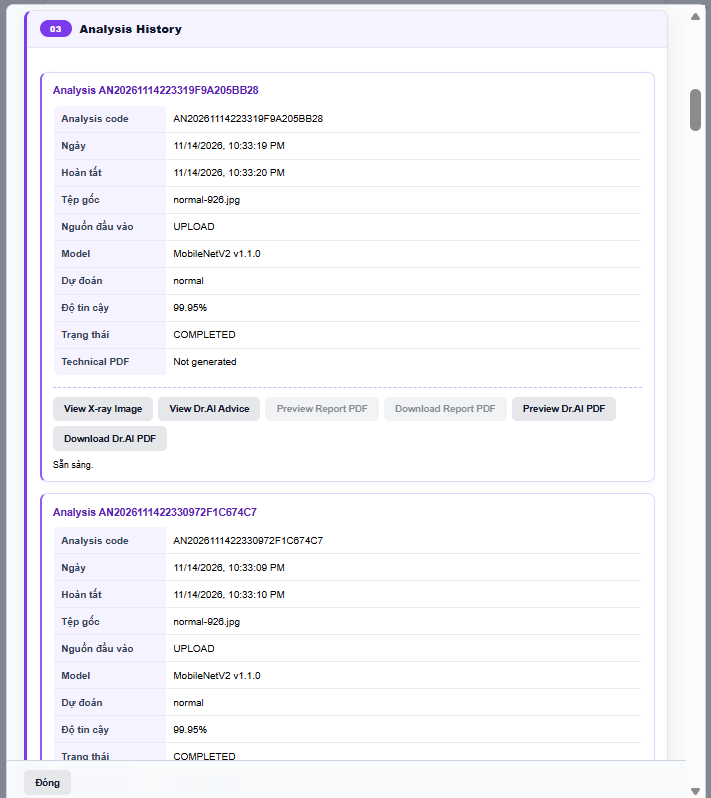
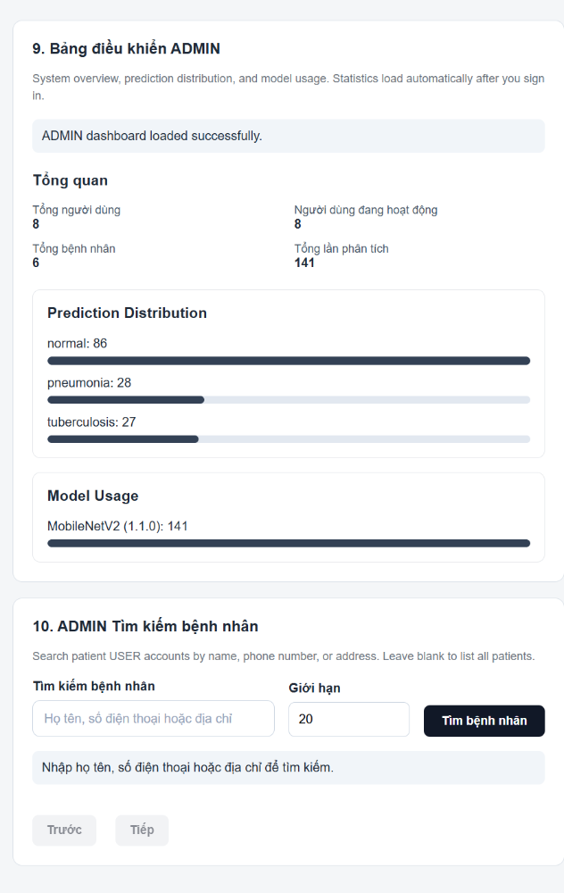
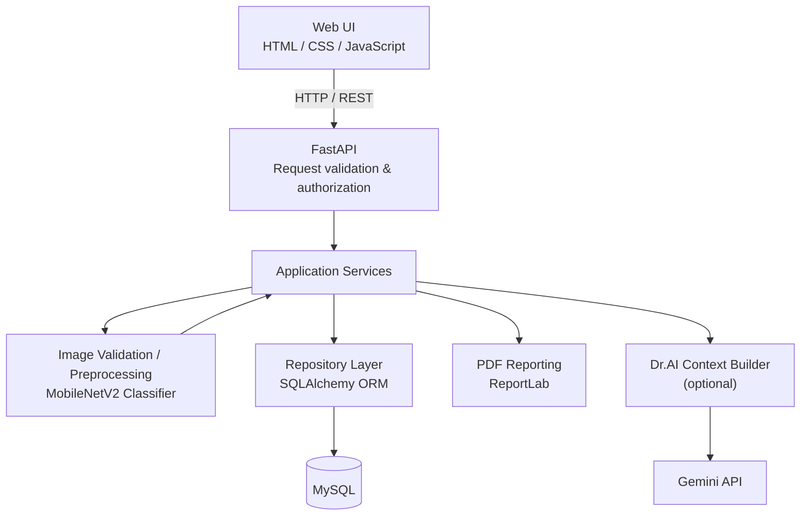

<div align="center">

# 🫁 LungXrayAI 2.0

### Development of an AI-Based Lung Disease Detection System Using Chest X-Ray Images

**A research-focused web application combining deep learning, REST APIs, relational data, and reporting.**

[](https://www.python.org/)
[](https://fastapi.tiangolo.com/)
[](https://www.tensorflow.org/)
[](https://www.mysql.com/)
[](https://www.docker.com/)
[](#model-and-evaluation)

[**Quick Start**](#quick-start-with-docker) · [**Architecture**](#system-architecture) · [**Model Results**](#model-and-evaluation) · [**API**](#api-and-database) · [**Testing**](#testing)

</div>

> [!CAUTION]
> **For education, research, and demonstration only.** LungXrayAI is **not a medical device** and must not be used as the sole basis for diagnosis, treatment, or other clinical decisions. Its model output scores are **not calibrated clinical disease probabilities**. Always defer medical decisions to qualified healthcare professionals.

## Overview

**LungXrayAI 2.0** provides an experimental workflow for classifying chest X-ray images as **Normal**, **Pneumonia**, or **Tuberculosis**. Beyond image inference, the application implements a layered **FastAPI backend**, **MySQL persistence**, role-based access control, patient and analysis history, PDF reporting, and optional **Dr.AI** explanations powered by the Gemini API.

This repository is an **academic Software Engineering and AI project**, not a clinically validated product.

| At a glance | Details |
| --- | --- |
| **Application version** | `2.0` |
| **Packaged classifier** | `MobileNetV2`, model version `1.1.0` |
| **Task** | Three-class chest X-ray image classification |
| **Backend / data** | FastAPI, SQLAlchemy, Alembic, MySQL |
| **Client** | HTML, CSS, JavaScript; English and Vietnamese |
| **Deployment** | Docker Compose or manual Python setup |
| **Reported held-out test accuracy** | **89.62%** on the documented test set; see [evaluation limitations](#model-and-evaluation) |

## 📸 Application Screenshots

A look at the main workflows of **LungXrayAI 2.0**: project overview, chest X-ray analysis, saved history, and administration.

### 01 — Guest Homepage

The public homepage presents the project objectives, supported disease classes, methodology, and research limitations.

<p align="center">
  
</p>

### 02 — User Prediction Results

Authenticated users can review the predicted class, the model's output scores across all three classes, and options for technical and Dr.AI reports. **Model scores are not clinical disease probabilities.**

<p align="center">
  
</p>

### 03 — Analysis History

Saved analysis records show timestamps, model version, predicted class, score, status, and available report-related actions.

<p align="center">
  
</p>

### 04 — Admin Dashboard

The administrative interface summarizes application usage, including user and patient counts, analysis totals, prediction distribution, and model usage.

<p align="center">
  
</p>

> **Demo data:** Patient information shown in the screenshots is fictional demonstration data. This application is for educational and research purposes only and is not a clinical diagnostic tool.


## Key Features

| Area | Capabilities |
| --- | --- |
| **X-ray analysis** | Input validation, single- and multiple-image workflows, preprocessing, MobileNetV2 inference, class-score visualization |
| **Accounts and roles** | Sign-up and sign-in; `GUEST`, `USER`, and `ADMIN` access; backend-enforced authorization |
| **Patient records** | Patient profiles, structured medical histories, and saved analysis history |
| **Reporting** | Technical analysis PDFs and separate Dr.AI explanatory PDFs |
| **Dr.AI (optional)** | Gemini-generated explanatory content using structured classifier output and selected patient context |
| **Administration** | Dashboard overview, patient search and review, analysis-related information, visitor statistics |
| **Localization** | English and Vietnamese interface; client-side language preference |

**Important boundary:** Medical-history fields can provide context to **Dr.AI**, but they do **not** change the image classifier's prediction. Dr.AI receives structured application data; it does **not** independently examine the original X-ray pixels.

## Quick Start with Docker

Docker Compose is the **recommended setup documented by the project**. You need Git and Docker with Compose support.

**1. Clone the repository**

```bash
git clone https://github.com/Mons1412/Development-of-an-AI-Based-Lung-Disease-Detection-System-Using-Chest-X-Ray-Images_v.2.0.git
cd Development-of-an-AI-Based-Lung-Disease-Detection-System-Using-Chest-X-Ray-Images_v.2.0
```

**2. Build and start the services**

```bash
docker compose up -d --build
docker compose ps
```

The documented Compose startup flow initializes MySQL, waits for its health check, runs Alembic migrations, registers the packaged model, and launches FastAPI.

**3. Create the first administrator (fresh database only)**

```bash
docker compose exec app python scripts/create_admin.py
```

Follow the secure CLI prompts. The installation intentionally has **no preset administrator password**; this script refuses to add another administrator if one already exists.

**4. Open the application**

- Web UI: `http://127.0.0.1:8000`
- Interactive API docs: `http://127.0.0.1:8000/docs`
- OpenAPI specification: `http://127.0.0.1:8000/openapi.json`

**5. Stop the services**

```bash
docker compose down
```

> [!WARNING]
> `docker compose down -v` **also removes the local MySQL Docker volume and its data**, including accounts and analysis records. Do not use it when you want to preserve the database.

For manual development and environment variables, see [Manual Development Setup](#manual-development-setup).

## System Architecture



The backend separates HTTP concerns, business logic, and infrastructure implementations:

- **API layer:** Requests, validation, authentication, authorization, and structured responses.
- **Application services:** Image analysis, patients, medical histories, analysis records, reports, administration, and Dr.AI context.
- **Infrastructure:** TensorFlow runtime, input preprocessing, SQLAlchemy repositories, PDF generation, and Gemini integration.

### Image analysis flow

```text
Upload image → Validate input → Preprocess (224 × 224 × 3)
             → MobileNetV2 → Class scores → Display results
                                          └→ Save analysis → MySQL
```

Dr.AI is a **separate explanatory workflow**. It uses selected structured results and patient context, and cannot alter the classifier output.

## Model and Evaluation

### Deployed classifier

| Property | Value |
| --- | --- |
| Architecture | MobileNetV2 with transfer learning |
| Model version | `1.1.0` |
| Input | `224 × 224 × 3` RGB |
| Preprocessing normalization | `[-1, 1]` |
| Output | Softmax over `Normal`, `Pneumonia`, `Tuberculosis` |
| Serialized model | Keras (`.keras`) |
| Packaged model directory | `app/artifacts/lung_classifier/1.1.0/` |

**Versioning note:** The **application** is version `2.0`, while the **packaged classifier** is version `1.1.0`. An application-version increase does not imply a new model training run. The chest X-ray input validator is version `1.0.0`.

The packaged model directory is documented to include model metadata, checksums, preprocessing configuration, class mapping, inference contract, metrics, and runtime requirements.

### Documented evaluation data

| Split | Images |
| --- | ---: |
| Training | 1,460 |
| Validation | 313 |
| Test | 318 |
| **Total** | **2,091** |

The documented balanced dataset contains **697 images per class** (Normal, Pneumonia, Tuberculosis).

### Reported test results

| Metric | Reported result |
| --- | ---: |
| Test accuracy | **89.62%** |
| Macro F1-score | **89.72%** |

| Class | Reported F1-score |
| --- | ---: |
| Normal | `0.8835` |
| Pneumonia | `0.8841` |
| Tuberculosis | `0.9239` |

> [!IMPORTANT]
> These are **reported results for the packaged v1.1.0 classifier on its documented test set**. They do not establish performance across hospitals, scanners, populations, or other unseen clinical settings. Softmax scores must not be interpreted as patient-level probabilities of disease.

## Technology Stack

| Layer | Technologies |
| --- | --- |
| **ML / inference** | Python, TensorFlow, Keras, MobileNetV2, transfer learning |
| **Backend** | FastAPI, Uvicorn, Pydantic |
| **Persistence** | MySQL, SQLAlchemy, Alembic |
| **Frontend** | HTML5, CSS3, JavaScript |
| **AI explanations** | Google Gemini API (optional Dr.AI workflow) |
| **Reporting** | ReportLab, PDF generation |
| **Delivery / development** | Docker, Docker Compose, Git, GitHub; Windows 11 and Ubuntu 24.04 |

## API and Database

The complete API contract is generated by FastAPI at `/docs` and `/openapi.json`. Representative endpoints listed in the project's original documentation are:

| Method | Route | Purpose |
| --- | --- | --- |
| `GET` | `/health/live` | Liveness probe |
| `GET` | `/health/ready` | Readiness probe |
| `GET` | `/api/v1/model-info` | Classifier metadata |
| `POST` | `/api/v1/predict` | Chest X-ray classification |
| `GET` | `/api/v1/patient-profile/me` | Read current patient profile |
| `PUT` | `/api/v1/patient-profile/me` | Update current patient profile |
| `GET` | `/api/v1/admin/dashboard/summary` | Admin dashboard summary |

Additional routes cover accounts, medical histories, analyses, medical advice, reports, patient administration, and visitor statistics. Protected routes require appropriate authentication/authorization; `/docs` is the source of truth for exact schemas and request examples.

### Persistence design

```text
FastAPI → Application Service → Repository → SQLAlchemy ORM → MySQL
```

The documented schema supports users, patient profiles and profile history, medical histories, model metadata, analyses, predictions and class probabilities, medical advice, report-related records, and visitor sessions.

**Alembic** manages schema migrations in `migrations/versions/`.

### Access roles

| Role | Intended access |
| --- | --- |
| `GUEST` | Public project view, language selection, sign-in and registration |
| `USER` | X-ray analysis, patient profile, medical history, analysis history, reports, and optional Dr.AI information |
| `ADMIN` | Protected dashboard, patient administration, analysis-related views, and visitor statistics |

The **backend** enforces authorization. Hiding frontend controls is a UI convenience, **not** an access-control mechanism.

## Dr.AI and Reports

The optional **Dr.AI** flow takes **classifier output + selected patient profile and medical-history context**, constructs a structured request, and uses **Gemini** to generate supplemental explanation.

```text
MobileNetV2 result + selected patient context
                  ↓
           Dr.AI context builder
                  ↓
               Gemini API
                  ↓
       Explanation for UI / Dr.AI PDF
```

It does **not** read raw X-ray pixels or provide an independent diagnosis. Its generated content can be wrong or incomplete and is not a substitute for clinical judgment.

The application documents two report types:

- **Technical analysis PDF:** X-ray image, predicted label, class-score distribution, model information, and analysis metadata.
- **Dr.AI PDF:** Structured, generated explanatory content based on application context.

The reporting implementation includes `reportlab_pdf_generator.py` and `drai_pdf_generator.py` in the infrastructure reporting layer.

## Manual Development Setup

> Docker Compose is recommended for a fresh setup. The following is the manual development path documented by the project; a separately configured **MySQL** server is required.

Requirements: **Python 3.12**, Git, and MySQL. Node.js is optional for frontend runtime tests.

**1. Clone and enter the repository**

```bash
git clone https://github.com/Mons1412/Development-of-an-AI-Based-Lung-Disease-Detection-System-Using-Chest-X-Ray-Images_v.2.0.git
cd Development-of-an-AI-Based-Lung-Disease-Detection-System-Using-Chest-X-Ray-Images_v.2.0
```

**2. Create and activate a virtual environment**

Linux / macOS:

```bash
python3 -m venv .venv
source .venv/bin/activate
```

Windows PowerShell:

```powershell
python -m venv .venv
.\.venv\Scripts\Activate.ps1
```

**3. Install Python dependencies and configure the environment**

```bash
python -m pip install --upgrade pip
python -m pip install -r requirements.txt
cp .env.example .env
```

On Windows PowerShell, replace the last command with `Copy-Item .env.example .env`. Set up the database connection and other applicable settings in your **local** `.env`. Never commit secrets or private patient information.

**4. Run database migrations**

```bash
alembic upgrade head
```

**5. Create the first administrator (if needed)**

Linux / macOS:

```bash
export PYTHONPATH="$PWD/app/src"
python scripts/create_admin.py
```

Windows PowerShell:

```powershell
$env:PYTHONPATH="$PWD\app\src"
python scripts/create_admin.py
```

This CLI-only setup requests the first administrator credentials securely, hashes the password, and refuses a second administrator creation if an `ADMIN` account already exists. Regular users sign in using a **phone number**; administrators use their **administrator username** in the same sign-in form.

**6. Run FastAPI**

Linux / macOS:

```bash
export PYTHONPATH="$PWD/app/src"
python -m uvicorn lung_xray_api.main:app --host 127.0.0.1 --port 8000
```

Windows PowerShell:

```powershell
$env:PYTHONPATH="$PWD\app\src"
python -m uvicorn lung_xray_api.main:app --host 127.0.0.1 --port 8000
```

Visit `http://127.0.0.1:8000` or the API documentation at `http://127.0.0.1:8000/docs`. The web assets reside in `frontend/`.

## Project Structure

<details>
<summary>Show the documented repository layout</summary>

```text
LungXrayAI2/
├── app/
│   ├── artifacts/
│   │   └── lung_classifier/1.1.0/
│   └── src/lung_xray_api/
│       ├── api/v1/
│       ├── application/services/
│       ├── core/
│       ├── domain/
│       ├── infrastructure/
│       │   ├── ml/
│       │   ├── persistence/orm/
│       │   ├── persistence/repositories/
│       │   └── reporting/
│       ├── schemas/
│       └── main.py
├── frontend/
│   ├── assets/
│   ├── index.html
│   ├── style.css
│   ├── script.js
│   ├── auth.js
│   ├── language.js
│   ├── role_visibility.js
│   ├── profile_ui.js
│   ├── medical_history_ui.js
│   ├── admin_patients.js
│   └── visitor_stats.js
├── migrations/versions/
├── tests/
│   ├── api/
│   ├── application/
│   ├── frontend/
│   ├── infrastructure/
│   ├── integration/
│   └── e2e_images/
├── scripts/create_admin.py
├── docker-compose.yml
├── Dockerfile
├── requirements.txt
├── .env.example
└── README.md
```

</details>

## Testing

The original project documentation lists tests across the API, application services, frontend, infrastructure, integration, and image end-to-end workflows.

**Python test suite:**

```bash
python -m pytest -q
```

**Example targeted backend test:**

```bash
python -m pytest tests/api/test_dashboard_summary_api.py -q
```

**JavaScript runtime tests** (with Node.js):

```bash
node --test tests/frontend/*.test.cjs
```

**JavaScript syntax checks:**

```bash
node --check frontend/language.js
node --check frontend/role_visibility.js
```

> **Testing status:** These commands come from the original README. This README does **not** claim that the latest commit has passed all tests or has a specific code-coverage percentage. Verify results in your own environment before adding CI, coverage, or performance badges.

## Security and Privacy

- **No default admin credentials:** Bootstrap the initial administrator via CLI; passwords are hashed before storage.
- **Server-side authorization:** Protected APIs are checked by the backend, even if frontend controls are hidden.
- **No committed secrets:** Store database passwords, API keys, tokens, and credentials outside Git; use `.env.example` as a template.
- **Sensitive data:** Patient records and X-ray images may be sensitive. Never publish real patient data in issues, screenshots, or demo databases.
- **Production considerations:** Encryption in transit and at rest, backups, audit logging, account security, data retention, and regulatory review would require further work.

This academic system should **not** be assumed to meet production healthcare security or compliance requirements.

## Limitations and Future Work

**Current limitations**

- Only the three documented classes are supported; this is **not** general-purpose chest-disease diagnosis.
- The model performs **classification**, not lesion localization, object detection, or medical-image segmentation.
- Performance is dataset-dependent; external clinical validation is not established here.
- Softmax scores are not real-world probabilities of disease.
- Dr.AI explanations may contain mistakes, omissions, or unsuitable recommendations.

**Potential future improvements**

- Larger, more diverse and externally validated datasets; comparison with newer model architectures.
- Model calibration and explainability; lesion localization and image segmentation.
- Stronger image validation and broader automated testing.
- Better authentication, audit logging, encrypted patient-data storage, and deployment security.
- Expanded administrator tools, cloud deployment, and CI/CD.

These items are **future work**, not currently verified capabilities.

## Academic Credits

**Project:** Development of an AI-Based Lung Disease Detection System Using Chest X-Ray Images  
**Vietnamese title:** HỆ THỐNG XÁC ĐỊNH BỆNH PHỔI THÔNG QUA ẢNH X-RAY  
**Institution:** Nguyen Tat Thanh University  
**Supervisor:** Dr. Trần Sơn Hải

**Project team:** Võ Nhật Nguyên · Vô Văn Nghĩa · Lê Đoàn Anh Tuấn (Toby / [Mons1412](https://github.com/Mons1412))

---

<div align="center">

**LungXrayAI 2.0** · Academic software engineering and AI research prototype

<sub>Not a medical device. Not intended for clinical diagnosis or treatment.</sub>

</div>
